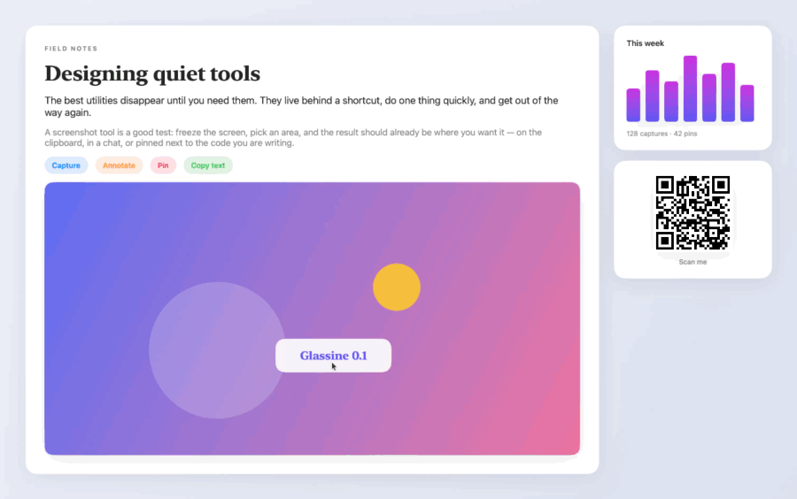
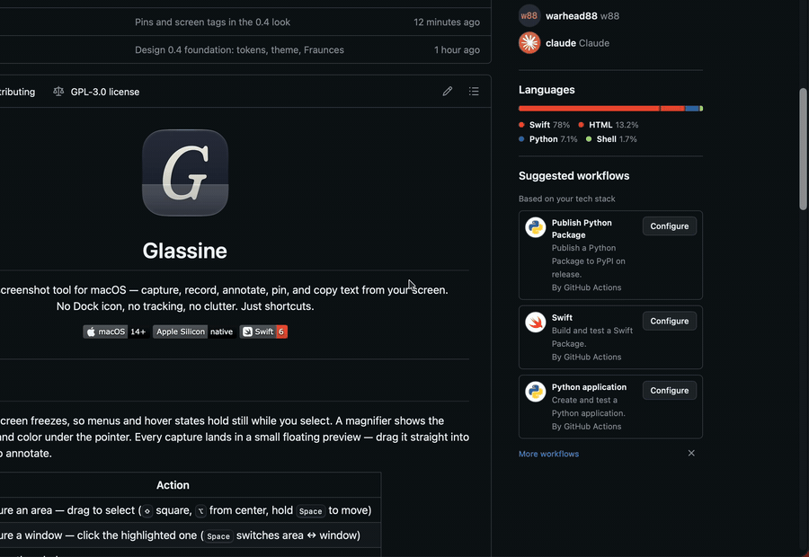
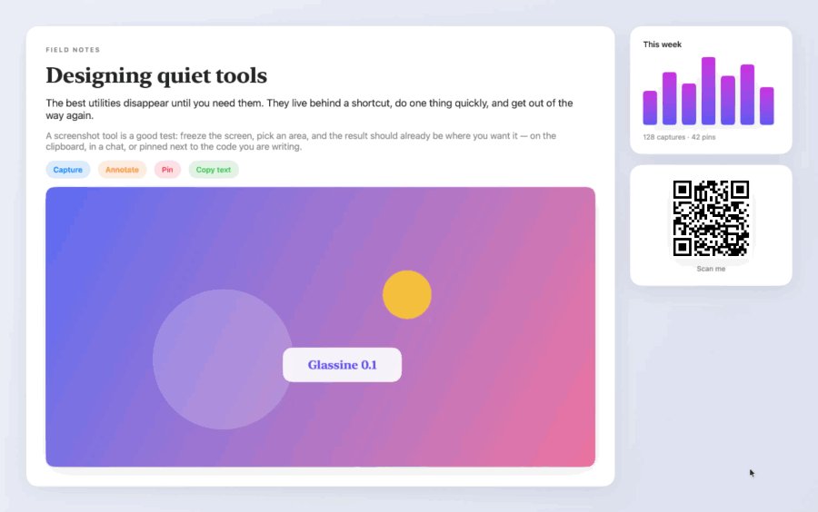

<p align="center">
  
</p>

<h1 align="center">Glassine</h1>

<p align="center">
  A quiet, native screenshot tool for macOS — capture, annotate, pin, and copy text from your screen.<br>
  No Dock icon, no network, no clutter. Just shortcuts.
</p>

<p align="center">
  
  
  
</p>

---

## Capture

Press <kbd>⇧⌘4</kbd> and the screen freezes, so menus and hover states hold still while you select.
A magnifier shows the pixels, coordinates and color under the pointer. Every capture lands in a small
floating preview — drag it straight into any app, or click it to annotate.

<p align="center"></p>

| Shortcut | Action |
|---|---|
| <kbd>⇧⌘4</kbd> | Capture an area — drag to select (<kbd>⇧</kbd> square, <kbd>⌥</kbd> from center, hold <kbd>Space</kbd> to move) |
| <kbd>⇧⌘5</kbd> | Capture a window — click the highlighted one (<kbd>Space</kbd> switches area ↔ window) |
| <kbd>⇧⌘3</kbd> | Capture the whole screen |
| <kbd>⌥⇧⌘T</kbd> | Copy text from the screen (on-device OCR, Russian and English) and read QR codes |
| <kbd>⌥⇧⌘C</kbd> | Pick a color (HEX, RGB or HSL) |
| <kbd>⌥⇧⌘M</kbd> | Measure distances in pixels and points |
| <kbd>⌥⇧⌘P</kbd> | Show / hide pins |
| <kbd>⌥⇧⌘,</kbd> | Settings |

All shortcuts can be changed in Settings. Repeat-last-area and timed capture are there too.

## Annotate

Arrows, shapes, text, pen, marker, numbered steps, blur, pixelate and redact — each on a single key.
Shapes switch back to Select when you finish, so you can resize them right away. Add padding, rounded
corners, a shadow and a background; it grows by itself when an arrow points past the edge.

<p align="center"></p>

## Pin

Keep a capture floating above every window — as a reference while you design or code. Scroll to zoom,
<kbd>⌥</kbd>-scroll for opacity, or let clicks pass through it.

<p align="center"></p>

## Copy text from the screen

Select any text — in an image, a video, a locked PDF — and it's on your clipboard. Recognition runs on
your Mac with Vision; QR codes are read too, with a button to open links.

<p align="center"></p>

## Install

1. Download `Glassine-<version>.dmg` from [Releases](../../releases).
2. Open it and drag **Glassine** to **Applications**.
3. Launch it and follow the welcome window: allow Screen Recording, and turn off macOS's own screenshot
   shortcuts (System Settings → Keyboard → Keyboard Shortcuts… → Screenshots) so Glassine gets
   <kbd>⇧⌘3</kbd>, <kbd>⇧⌘4</kbd> and <kbd>⇧⌘5</kbd>.

Current builds aren't notarized yet: on a Mac other than the developer's, macOS asks once before the
first launch — right-click Glassine → **Open**.

To remove Glassine: Settings → General → **Uninstall…** — the app, its settings and caches go to the
Trash; your screenshots stay.

## Privacy

Everything stays on your Mac. Glassine never connects to the network, has no analytics, and writes only
to its own folders (named `com.warhead88.glassine`) and the screenshot folder you choose.

## Build from source

Requires Xcode 26 or later and [XcodeGen](https://github.com/yonaskolb/XcodeGen).

```bash
scripts/install.sh     # build and install to /Applications (pass Release for a release build)
scripts/test.sh        # unit tests (Swift Testing)
scripts/release.sh     # Release build packed as dist/Glassine-<version>.dmg
```

The Xcode project is generated from `project.yml`. Code lives in `Glassine/` by feature —
`Capture`, `QuickAccess`, `Editor`, `Pins`, `Smart`, `Settings`; design sources and the icon in `Design/`.
See [ROADMAP.md](ROADMAP.md) for what's next and [TESTING.md](TESTING.md) for the manual checklist.
